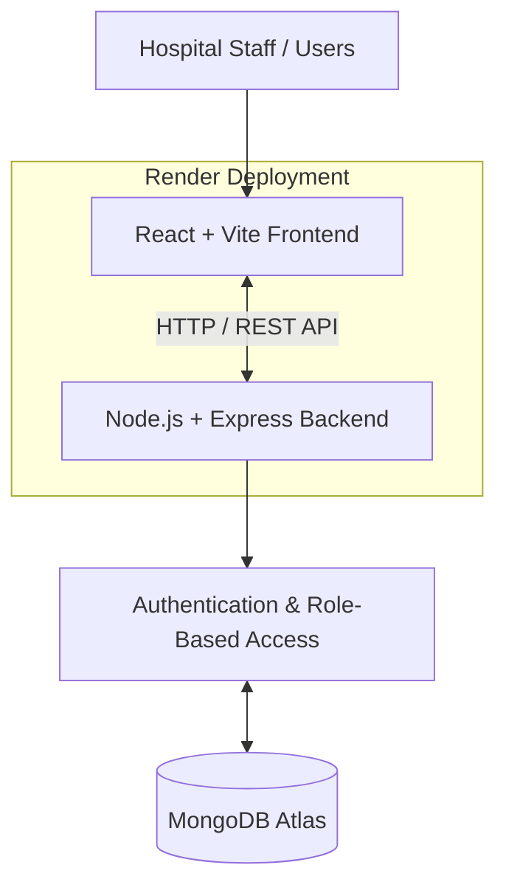

# CareSync — Patient Records Management Portal

## 🔗 Live Demo & Quick Start

* **Live Application (Frontend):** [Open CareSync](https://caresync-frontend-u650.onrender.com)
* **Backend API:** [CareSync Backend](https://caresync-1-0fux.onrender.com/api)
* **GitHub Repository:** [View Source Code](https://github.com/Praharshitha07/caresync)

### How to Open and Use the Application

**Step 1: Open the live application**

Open the CareSync frontend link above in your browser. The frontend is the main link required to access and evaluate the application.

**Step 2: Choose a demo account**

Use the designated demo credentials below to sign in with the required role.

| Role          | Email                     | Password                     |
| ------------- | ------------------------- | ---------------------------- |
| Administrator | `praharshithamalladi@gmail.com`  | 123456789012        |
| Doctor        | `sneha.varma06@gamil.com`       | `snehavarma06`       |
| Receptionist  | `priya.krishna25@gmail.com` | `priyakrishna` |


**Step 3: Sign in and explore**

Enter the credentials for your selected role and sign in. Explore the dashboard and the features available to that role.

**Step 4: Evaluate role-based access**

Verify that each account can access its permitted features and that restricted operations are not available to unauthorized roles.

**Note:** The frontend communicates with the backend API automatically. You do not need to open the backend URL separately to use the application.

---

## 📌 Project Overview

CareSync is a full-stack Patient Records Management Portal designed to support hospital information management through a centralized digital platform.

The application enables authorized hospital staff to manage patient information, medical records, appointments, and staff-related operations. It incorporates authentication and role-based access control to help ensure that users can access only the features permitted for their roles.

The project demonstrates the development, integration, and deployment of a modern web application using React, Node.js, Express.js, and MongoDB Atlas.

## ✨ Key Features

* **Dashboard:** Centralized overview of application activities.
* **Patient Management:** View and manage patient information according to permissions.
* **Medical Records Management:** Access and maintain patient medical records.
* **Appointment Management:** Organize and manage patient appointments.
* **Doctor Management:** Manage doctor-related information and access.
* **Staff Management:** Support administrative staff operations.
* **Authentication:** Secure user login and session management.
* **Role-Based Access Control (RBAC):** Provide role-specific access for administrators, doctors, and receptionists.
* **Responsive User Interface:** Access the portal through supported browsers and devices.
* **Cloud Deployment:** Independently deployed frontend and backend services connected to MongoDB Atlas.


## 🛠️ Technology Stack

| Component       | Technology                       |
| --------------- | -------------------------------- |
| Frontend        | React, Vite, JavaScript, CSS     |
| Backend         | Node.js, Express.js              |
| Database        | MongoDB Atlas                    |
| ODM             | Mongoose                         |
| API             | REST API                         |
| Authentication  | Session-based authentication     |
| Authorization   | Role-Based Access Control (RBAC) |
| Deployment      | Render                           |
| Version Control | Git and GitHub                   |

## 🏗️ System Architecture

CareSync follows a client-server architecture in which the frontend communicates with the backend through HTTP API requests. The backend processes requests, applies authentication and authorization rules, and interacts with the database.

### Architecture Diagram




### Application Flow

1. The user opens the CareSync frontend and signs in.
2. The frontend sends authentication and application requests to the backend API.
3. The backend validates the request and checks the user's permissions.
4. Authorized requests interact with MongoDB Atlas through Mongoose.
5. The backend returns the appropriate response to the frontend.
6. The frontend displays the result to the user.

## 👥 User Roles and Access

CareSync is designed to support multiple categories of hospital personnel through role-based access control.

| Role                 | Responsibilities                                                                                                                           |
| -------------------- | ------------------------------------------------------------------------------------------------------------------------------------------ |
| Administrator        | Manage authorized administrative operations, staff information, and system access.                                                         |
| Doctor               | Access permitted patient information, medical records, and clinical workflows.                                                             |
| Receptionist         | Handle permitted patient registration and appointment scheduling workflows.                                                                |
| Other Hospital Staff | Support hospital operations, including nursing and patient-care activities, according to assigned responsibilities and access permissions. |

**Note:** The features and permissions available to each role depend on the roles implemented and configured in the application.


## 📁 Project Structure

The repository is organized into a frontend application at the root and a backend application inside the `server` directory.

```text
caresync/
├── public/                  # Public frontend assets
├── src/                     # Frontend source code
│   ├── components/          # Reusable UI components
│   ├── pages/               # Application pages
│   ├── services/            # API communication, if present
│   └── ...                  # Other frontend modules
├── server/
│   ├── src/
│   │   ├── config/          # Environment and database configuration
│   │   ├── routes/          # API routes, if organized here
│   │   ├── middleware/      # Authentication and request middleware
│   │   ├── models/          # Database models, if organized here
│   │   ├── controllers/     # Request handlers, if organized here
│   │   ├── app.js           # Express application setup
│   │   └── server.js        # Backend entry point
│   └── package.json         # Backend dependencies and scripts
├── .env.example             # Frontend environment template
├── package.json             # Frontend dependencies and scripts
├── README.md                # Project documentation
└── .gitignore               # Files excluded from version control
```

*This is a logical overview. Directory names should be adjusted to match the actual repository structure.*

## 🚀 Running the Project Locally

### Prerequisites

Install the following:

* Node.js and npm
* Git
* A MongoDB Atlas database or another supported MongoDB instance
* A code editor such as Visual Studio Code

### Step 1: Clone the repository

Open a terminal and run:

```bash
git clone https://github.com/Praharshitha07/caresync.git
cd caresync
```

### Step 2: Configure the frontend

Install frontend dependencies:

```bash
npm install
```

Create a `.env` file in the project root using `.env.example` as a reference.

For local development, configure the API URL:

```env
VITE_API_BASE_URL=http://localhost:5000/api
```

Ensure the port and API prefix match the backend configuration.

### Step 3: Configure the backend

Open a second terminal and navigate to the backend:

```bash
cd server
npm install
```

Create a `server/.env` file and configure the environment variables required by the backend.

Example configuration:

```env
NODE_ENV=development
MONGODB_URI=YOUR_MONGODB_CONNECTION_STRING
```

Add the session secret and any other variables required by the actual backend configuration. Use the variable names defined by the project; do not commit real credentials or secrets.

### Step 4: Start the backend

From the `server` directory, run:

```bash
npm start
```

Confirm that the backend starts successfully and connects to the configured MongoDB database.

### Step 5: Start the frontend

In a separate terminal, return to the project root:

```bash
cd ..
npm run dev
```

Open the local frontend URL printed by Vite in the terminal, commonly:

`http://localhost:5173`

### Step 6: Verify the local application

* Confirm that the frontend loads.
* Verify that the frontend points to the local backend API.
* Sign in with an appropriately configured local account.
* Test the permitted operations for each role.
* Confirm that database changes persist after refreshing the application.

## 🔐 Demo Access

Dedicated demo accounts are intended for project evaluation.

* **Administrator:** Administrative operations permitted by the application.
* **Doctor:** Authorized clinical and patient-record workflows.
* **Receptionist:** Authorized front-desk and appointment workflows.

Use the demo credentials in the Quick Start section. Demo accounts should contain only fictional sample data and should not use personal or production credentials.

After evaluation, disable the demo accounts or rotate their passwords.

## ⚙️ Environment Configuration

Frontend and backend configuration are maintained separately.

### Frontend

The frontend uses the `VITE_API_BASE_URL` variable to identify the backend API.

* Local development: Use the local backend API URL.
* Production: Use the deployed backend URL followed by the configured API prefix.

### Backend

The backend configuration is defined in the server environment configuration.

Typical settings include:

* `NODE_ENV`
* `MONGODB_URI`
* Session-related secrets and any other required application variables
* The allowed frontend origin, if required by the backend configuration

Set production environment variables in the relevant Render service dashboard. Keep secrets out of the repository and public documentation.

## ☁️ Deployment

CareSync is deployed using Render and MongoDB Atlas.

| Service  | Platform           | Purpose                                 |
| -------- | ------------------ | --------------------------------------- |
| Frontend | Render Static Site | Hosts the user interface                |
| Backend  | Render Web Service | Runs the REST API and application logic |
| Database | MongoDB Atlas      | Stores application data                 |

The frontend and backend are deployed independently. The frontend's API URL must point to the correct production backend, and the backend must allow requests from the deployed frontend origin.

After changing frontend build-time environment variables, trigger a new frontend deployment.

## 🧪 Verification and Testing

Before submitting the project for evaluation, verify the following:

* The live frontend opens successfully.
* The backend health endpoint responds as expected.
* Demo login works for each configured role.
* Sessions persist as expected across navigation and page refreshes.
* Role-based restrictions are enforced.
* Patient information can be accessed through authorized workflows.
* Medical-record and appointment operations work as implemented.
* Data persists in MongoDB Atlas.
* Direct route navigation and browser refresh work.
* No secrets or private credentials are exposed in the repository.

## 🔒 Security Notes

* Environment files containing secrets must not be committed to GitHub.
* Database credentials and session secrets must be stored in deployment environment settings.
* Authentication and authorization must be enforced by the backend.
* Demo accounts should use restricted permissions and fictional sample data.
* Public demo credentials should be temporary and rotated or disabled after evaluation.
* Do not enter real patient or other sensitive personal information into a public demonstration environment.

## 🎯 Project Purpose

CareSync was developed as a full-stack hospital information management project to demonstrate patient-record workflows, appointment management, staff access, authentication, role-based authorization, database integration, and cloud deployment.

The application is intended for educational demonstration and project evaluation. It should not be treated as a production-ready hospital information system without appropriate clinical, privacy, security, and regulatory reviews.

## 👩‍💻 Author

**Praharshitha Malladi**

Computer Science and Engineering Student

* **GitHub:** [Praharshitha07](https://github.com/Praharshitha07)
* **Project Repository:** [CareSync](https://github.com/Praharshitha07/caresync)

## 📄 License

This project was developed for hospital information management purposes as an educational and demonstration project.

A formal open-source license can be added if the project is intended for public reuse. Until a license is selected and included in the repository, no explicit open-source reuse permissions are granted.
